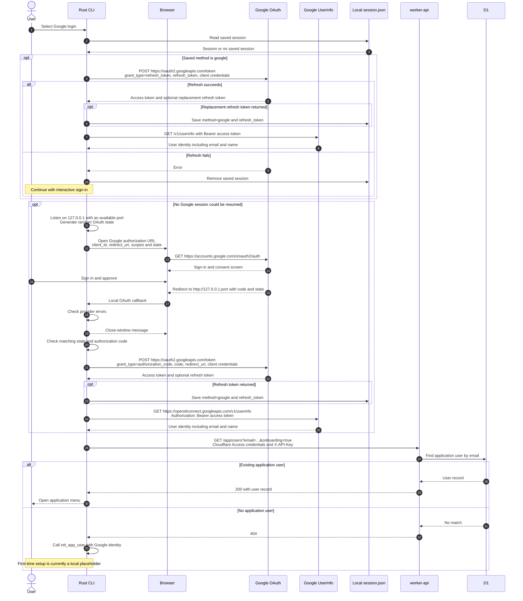

# Login with Google

The CLI signs in directly with a Google account using the authorization code flow and retrieves the user's email and profile through OpenID Connect. It requests identity scopes only; it does not access Gmail messages.

