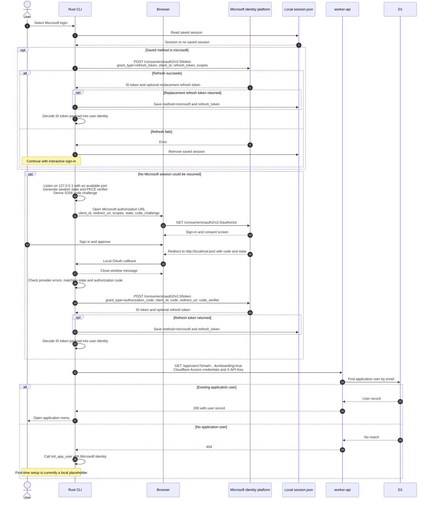

# Login with Microsoft

The CLI signs in directly with Microsoft using the authorization code flow with PKCE. The current implementation targets personal Microsoft accounts through the `consumers` endpoint.

