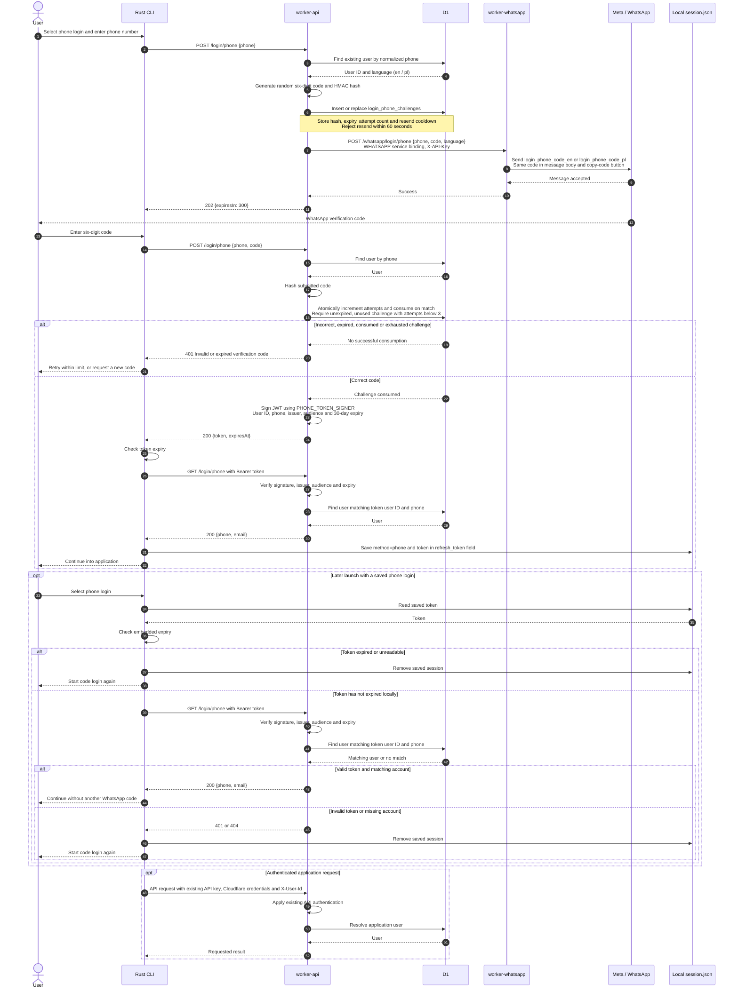

# Login with phone

Phone login requires an existing user. Codes expire after **5 minutes**, allow **3 attempts**, and can be requested once per **60 seconds**. Signed tokens expire after **30 days**; the backend stores no sessions.

